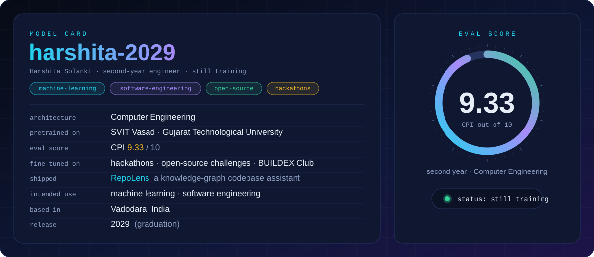
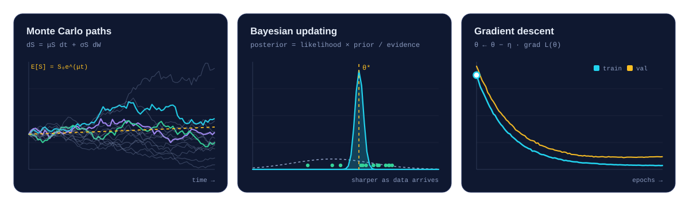
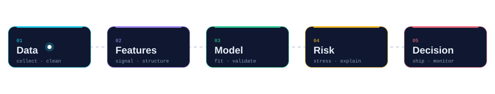

 

<h3 align="center">👋 Hello, world</h3>

I'm <b>Harshita</b>, a second-year Computer Engineering student at SVIT Vasad in Vadodara, graduating in 2029. 
I'm focused on machine learning and software engineering, and I learn by building. 
I'm an active member of the BUILDEX Club and take part in hackathons and open-source challenges. 
<a href="https://github.com/harshita2029/repolens"><b>RepoLens</b></a> is my main project so far.

 

<h3 align="center">📈 Models in motion</h3>

 

<h3 align="center">🧰 Toolkit</h3>

 

<h3 align="center">🔬 Featured project</h3>

 

**[View RepoLens on GitHub →](https://github.com/harshita2029/repolens)**

 

<h3 align="center">🧭 How I approach a problem</h3>

 

<h3 align="center">📊 Activity</h3>

  

<picture>
  <source media="(prefers-color-scheme: dark)" srcset="https://raw.githubusercontent.com/harshita2029/harshita2029/output/github-snake-dark.svg"/>
  
</picture>

 

<!--
Optional: add contact buttons just above the footer once you have the links.

-->
